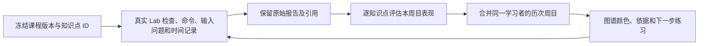

# LinuxLab 到持久知识图谱的自动反馈

## 实现线路

先固定评估对象，再判断证据是否支持该对象，最后更新学习者状态。
课程发布图谱和知识点 ID 是长期资产；实训结果只能关联这些节点，不能重新生成或改写它们。

`linuxlab-mastery-v3` 是透明的规则评估：它估计本实训内的操作表现，不伪装人工审核、
概念理解的确定结论或经过统计校准的掌握概率。人工确认状态与自动评估并列保存和展示。

## 什么证据能改变什么判断

| 观察 | 自动评估 |
| --- | --- |
| 尚无该节点观察 | 尚未涉及 |
| 只有通关、观察缺失、别名或未知语法、使用自动修复 | 证据不足，不因通关批量提升整关节点 |
| 直接关联的检查或命令仍失败 | 需要练习，并附原始引用；不声称已查明心理原因 |
| 相关操作和检查通过，但使用了提示或助教 | 借助提示完成 |
| 相关操作和检查通过，成功操作前查阅过对应笔记或原生帮助 | 参考资料完成，不计入无辅助成功连胜 |
| 直接操作和检查通过，未记录提示/修复；或自行修正后通过 | 初步掌握 |
| 连续至少两个不同原生周目有直接成功依据，近期没有反复输入问题 | 较稳定，范围仍限于此实训 |

正向命令映射显式写在 `pliac/linux_mastery.py`，例如 `cp` 操作对应 `cp` 节点。
对绝对路径语义等缺少直接观察依据的抽象概念，不因为操作成功而自动宣称掌握。
只使用直接关联知识点，先修关系不传播扣分。命令成功退出需同时有对应关卡通过才提供正向支持。
同一阶段曾用自动修复，不用该阶段结果提升估计；提示或助教即便记为零级也按帮助处理。

## 笔记与原生帮助查阅

`lab chat` 的学习者原话与助教回复会进入独立的对话诊断链路，详见 [对话辅助诊断](linuxlab-integration.md#对话辅助诊断)。AI 的讲解是帮助背景，学习者的解释是待核验表达，两者都不会仅凭聊天就自动提升掌握等级。现有求助事件仍参与“借助提示完成”的判断；对话候选不计作新增操作失败，也不向先修节点传播。模型判断与原始发言分别保存。

- 采集 `lab notes <主题>`、`命令 --help`、`man 命令`（含数字手册节）、`help 命令`；
  另记录 `lab help`、`lab --help`、笔记目录/全文，但不把通用浏览归因到整关知识点。
- 只保留来源、白名单主题、关卡、时间、操作游标和完成后标记，不保存原始命令、路径或帮助正文。
  原生帮助须正常退出且属于可解释的简单命令；别名、函数、组合输入和失败的帮助请求不当作有效查阅。
- 按主题映射直接节点及依赖该操作证据的节点，例如 `cp` 对应复制和副本完整性；不向先修链传播。
- 同关查阅发生在最后一次符合要求的成功操作之前，且关卡通过，才标为“参考资料完成”。
  查询后仍失败保留“需要练习”；提示和修复的原有限制优先。
- 成功操作之后查阅、其他关卡的复盘、通关后阅读不回溯降低之前的表现，也不刷新旧表现的评估时间。
  查阅本身不证明该主题已经练习过；只有查阅而无任务操作时不创建新的掌握结果。
- 最近最多三个不同原生周目中，至少两个存在成功前查阅，显示“反复查阅依赖”；
  同一周目刷新或重复查阅不增加周目数。之后新的无辅助成功可以恢复提升。
- `lab tracking off` 同时停止查阅采集。最多保留 2000 条查阅及总计数；截断时不提供正向提升。
  旧记录缺少这类采集时不能补推历史查阅；外部浏览器、直接阅读文件、Vim 内部 `:help` 尚未采集。

## v3：求助、纠错与后续独立复测

行为序列来自不可变报告中的检查 ID、操作序号和查阅游标，不调用大模型。每个节点在原有总评之外展示正确性、独立性、纠错能力、操作流畅度、保持与迁移五项说明。

- 同关相关查阅区分：出错后查阅并修正、查阅后完成、查阅后同类检查错误仍出现、查阅后仍失败、成功后复查、等待后续操作，以及过程不足无法判断。
- 操作序号确定命令与查阅的先后。同游标的检查和查阅只有时间严格可比时才确定顺序；相同时间或时间缺失保持未知。聚合输入问题不被展开成虚构的逐次操作。
- 查阅后出现正确操作且检查通过，提供有效利用资料的行为证据，仍标为“参考资料完成”。时间先后不证明学习的因果关系。
- 失败检查之后必须有新的相关成功操作才认定修正；失败之前的成功命令不能用来充数。修复、缺失记录和未知命令语义继续阻止正向提升。
- 反复检查同一个未改变的现场不增加问题段。最近三个不同原生周目中的同类检查问题分开记录问题段数、涉及周目数和已修正数；反复出现时暂不提升为较稳定。检查类别相同不代表已确定同一种心理原因。
- 后续独立复测要求不同原生周目、相同任务标识与任务契约、完整过程、没有相关帮助或修复，以及相关操作与检查通过。后续阶段实际开始时间必须晚于先前观察时间，不能拿同步时间证明先后。自行纠错后通过与无错误通过分开说明；未修正输入问题不构成独立复测成功。
- 每关保存并展示最近 20 次查阅的行为顺序摘要，完整查阅仍保留在原始报告和查阅列表中。是否使用过参考资料基于完整记录判断，不因摘要截断变为独立完成。
- 独立复测可以支持先前求助/困难之后的操作改善；重复同一任务不能证明新任务迁移。展示间隔小时数，不使用未经校准的“隔几小时就证明长期掌握”阈值。记录始终保留 `transfer_verified=false`。

复制任务在现有 `cp` / `file_integrity` 节点下附加隐藏文件完整性、目标目录层级、原件保留、源与目标角色检查项，不创建或改写课程节点。隐藏项/嵌套问题必须把复制后事实与紧邻失败检查配对；其他阶段的现场快照不重新评定复制任务。角色记录只说明观察到了哪些操作数，不证明路径概念理解。

### 研究借鉴及边界

- [Aleven 等，2016，Help Helps, But Only So Much](https://www.cs.cmu.edu/~aleven/Papers/2016/Aleven_etal_IJAIED2016-Helpseeking.pdf)：借鉴有上下文的求助分析，不把全部帮助使用视为未掌握。
- [Baker 等，2008，上下文 slip/guess 知识追踪](https://www.cs.cmu.edu/~rsbaker/BCA2008V.pdf)：借鉴区分偶发失误与持续困难，不复制其拟合参数。
- [Jadud，2006，初学者编译行为分析](https://jadud.com/dl/pdf/2006-icer-jadud.pdf)：借鉴连续错误与纠错片段，不将编译错误商直接宣称为 Linux 掌握概率。
- PFA/FAST 等统计模型仍需真实练习数据和独立后测；当前不训练模型、不输出未经校准的百分比。将来应比较对后续独立任务的预测与现有规则基线，按学习者及时间隔离验证数据，并保留新任务变体/延迟复测；不能以本规则生成的标签作为真实掌握标签循环验证。

已有导入记录可运行 `python scripts/refresh_linux_assessments.py` 更新评估。该命令只重放已导入的不可变原始报告，不读取尚未同步的终端工作，不重写原始报告或发布图谱；策略升级保持各节点原表现时间，旧评估快照保留。没有历史查阅记录时不能补造。

## 打错字、反复试错和停留时间

- 保留命令拼写、大小写、分隔、参数等已有输入诊断类别，并关联直接命令节点和语法节点。
- 同一问题现场的重复检查/输入次数不当作多个独立问题段。
- 最近最多三个不同周目只有一个问题段时标为偶发失误，不因打错一次降级。
- 多个问题段反复出现时标为反复易错，即使最终通过也暂不升为较稳定；当前有反复未修正问题时建议针对性练习。
- 用每关的检查和命令时间戳估计连续操作间隔；超过 120 秒的间隔单列为无法解释的空档。
  这不是真实专注时长，不区分思考、查资料、程序运行或离开，且不施加任何计时限制。
- 至少积累三次本人在同一关卡的完整成功记录才比较用时，基线取最近五次可比记录的中位数。
  达到基线两倍且至少 30 秒时显示“比自身近期更费时”；伴随反复错误或提示依赖时作为熟练度困难的辅助依据。
  用时信号单独不会降低掌握等级；没有基线或有长空档时不作快慢判断。

这些阈值是可解释的首版产品规则，尚未经过真实学习效果校准。当前观察粒度是任务关卡和命令类别，
没有采集 Vim 内部按键、光标位置或浏览器外查资料过程。

## 持久化与版本

- 原始报告：`linuxlab/runs/<绑定>/raw/<摘要>.json`。
- 单周目评估：同目录 `assessments/<摘要>.json`，当前结果亦保存在 `import.json`。
- 学习者历次评估：与证据共用版本化 HEAD，保存于 `workspace.linuxlab.<绑定>.assessment`。
- 图谱 API：`learner.states.<知识点>.auto_assessment`；不改写原有 `status` 或人工诊断。
- 同一原生存档即便绑定多次也只算一个周目。重复同步不增加尝试数或学习者版本。
- 新的直接表现可提升或降低等级；旧周目中其他关卡的同步不刷新本节点的评估时间，防止盖过新错误。
- 节点内容指纹变化、删除后重建或历史版本不兼容时排除旧估计，保留历史原始记录。
- 草稿试跑只保存该周目快照，不混入正式学习者状态。

图谱与 LinuxLab 使用同一课程内学习者编号。已有图谱打开、刷新和同步均不调用 AI 生成。
图谱默认按自动评估着色（存在评估时），可以切换到确认状态或单元族群。
节点详情给出依据、熟练度、时间信号、下一步建议，并能回到对应实训周目核对原始记录。

## 验证

`tests/test_linux_mastery.py` 覆盖升降级、帮助、修复、观察缺失、重复同步、身份隔离、重启读取、
版本变化、旧周目回写、偶发/反复笔误和个人时间基线。
`tests/test_ui_existing_graph.py` 验证错误到修正后的节点颜色变化、依据显示、跨页面身份和图谱文件不变。
`tests/test_ui_linux_lab.py` 通过临时存储中的真实 WSL Bash 验证输入错误、备份错误和证据同步。
测试记录全部为隔离的合成数据，不是学习效果试验。
